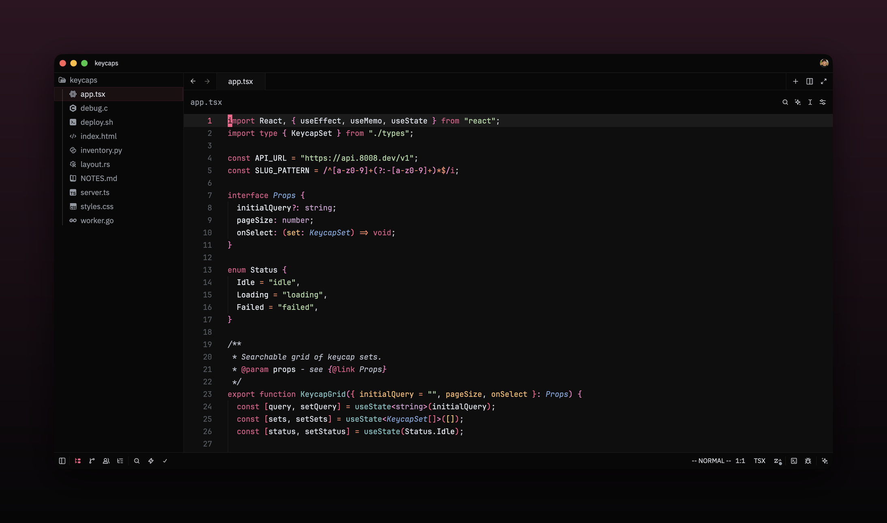
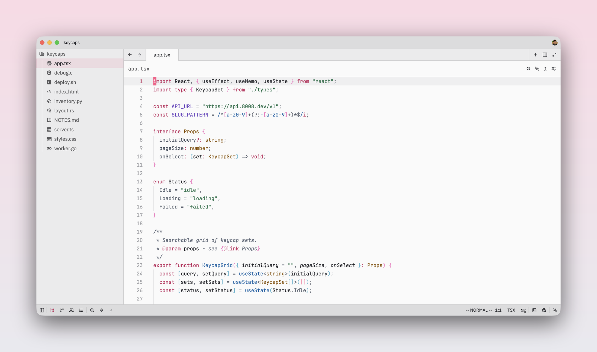
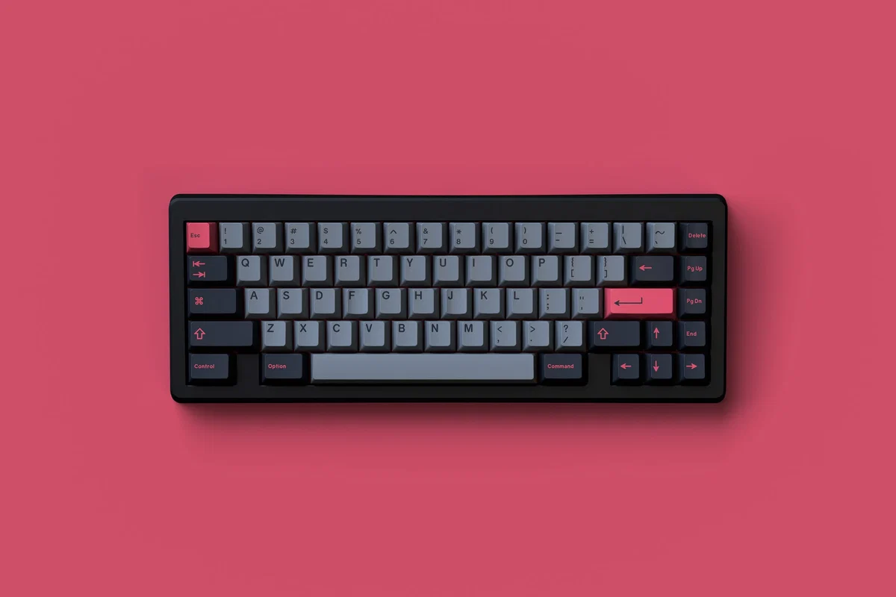

# zed 8008

for the loving of computing and keyboards

a gmk 8008 inspired theme for zed

**screenshots**

**enjoy!**

[inspo](https://prototypist.net/products/in-stock-gmk-cyl-8008-r2-keycap-set)

**credits**

the theme was inspired by the **gmk 8008** keycap set, originally run as a group
buy by [omnitype](https://omnitype.com/products/gmk-8008-2-keycap-set) (previously known as dixie mech) in 2019, with later groupbuy rounds through
omnitype and
[prototypist](https://prototypist.net/products/in-stock-gmk-cyl-8008-r2-keycap-set).

this theme is an independent, non-commercial fan made project. it is not affiliated
with, endorsed by, or sponsored by gmk electronic design gmbh, dixie mech, or omnitype. "gmk" and all product names are the property of their respective owners.

**license**

the [mit license](./LICENSE) applies to the theme files in this repository. any
referenced trademarks and third-party photographs are the property of their
owners and are not covered by it.
